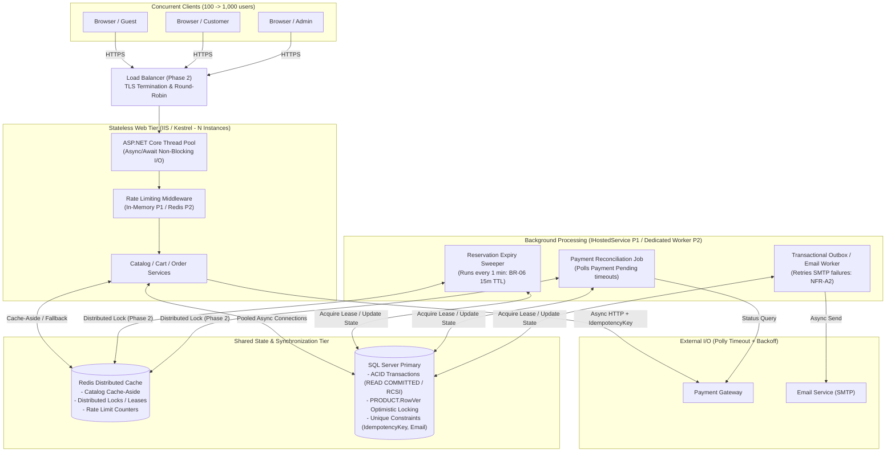
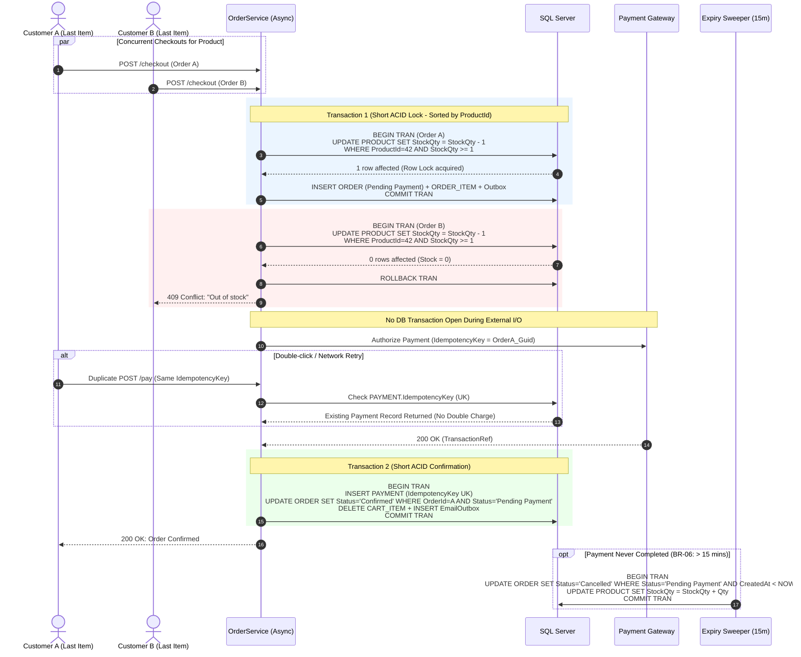

# Concurrency View & Analysis — E-Commerce Platform

**Stack:** ASP.NET Core MVC, SQL Server, Caching (In-Memory / Redis)  
**Baseline Target:** 100 concurrent users (with a 10x scale-out path to 1,000 concurrent users), catalog p95 < 500 ms, search p95 < 800 ms, checkout < 2 s (excluding gateway latency).

---

## 1. Concurrency Analysis & Contention Hotspots

The primary concurrency hazards arise from **shared mutable state** (inventory, order status, coupons, cache entries) and **unreliable external I/O** (payment gateway and SMTP email delivery).

| Contention Hotspot | Relevant Spec Items | Concurrency Risk | Required Guarantee |
| :--- | :--- | :--- | :--- |
| **Inventory / Stock Deduction** | UC-08, UC-16, BR-02, BR-06, NFR-D5 | Two customers purchase the last item simultaneously (**lost update / overselling**). | Strictly serialized or atomic stock decrement; `StockQty` never drops below `0`. |
| **Stock Reservation Expiry** | UC-08, BR-06 | Background job releases stock at the exact moment a delayed payment confirmation arrives. | Transactional state check before restoring stock or confirming an order. |
| **Payment Execution** | UC-09, NFR-A3, NFR-A4 | Double-click on "Pay" or network retry causes **duplicate charges**. | Idempotency enforced via unique `PAYMENT.IdempotencyKey`. |
| **Order Cancel vs. Ship** | UC-11, UC-17, BR-04 | Customer cancels an order while an Admin simultaneously marks it `Shipped`. | Atomic state-machine guard (`WHERE Status IN ('Pending Payment', 'Confirmed', 'Packed')`). |
| **Coupon Redemption** | UC-08, BR-05 | Customer submits two parallel checkouts to reuse a single-use coupon. | Unique constraint or transactional check on `(UserId, CouponId)` redemption. |
| **Cache Stampede & Staleness** | UC-04, UC-05, UC-15, Sec. 6.10, NFR-P4 | Hot catalog key expires under load, causing 100 concurrent threads to hit SQL Server simultaneously; or Admin updates a product while a stale read repopulates the cache. | Single-flight / request coalescing on cache miss; explicit invalidation on write; graceful DB fallback. |
| **Auth Lockout & Rate Limiting** | UC-02, NFR-SEC5, NFR-S1 | Brute-force requests spread across multiple web instances bypass in-memory counters. | Shared state in SQL Server (Identity lockout) and Redis (distributed rate limiting in Phase 2). |
| **Cart Merge & Multi-Tab Edits** | UC-02, UC-07 | Concurrent "Add to Cart" requests or guest-to-user merge creates duplicate `CART_ITEM` rows. | Unique index on `CART_ITEM(CartId, ProductId)` with upsert (`MERGE` / atomic increment). |

---

## 2. Execution Units & Process Architecture

To satisfy stateless horizontal scalability (NFR-S1) and prevent thread-pool starvation under concurrent I/O, the runtime is partitioned into **asynchronous HTTP request pipelines** and **decoupled background workers**.



### Runtime Execution Units

* **ASP.NET Core Web Process (Kestrel / IIS):**
  * **Threading Model:** Every database call (EF Core / Dapper), cache call (Redis), and HTTP call (Payment Gateway) must be strictly `async`/`await` end-to-end. Blocking calls (`.Result`, `.Wait()`) are prohibited to avoid thread-pool starvation at 100+ concurrent users.
  * **DbContext Lifetime:** Scoped strictly per HTTP request. Never register `DbContext` as a singleton or share an instance across parallel `Task.WhenAll` branches, as EF Core `DbContext` is not thread-safe.
  * **Connection Pooling:** Managed by `Microsoft.Data.SqlClient` (default max pool size 100 per web instance). Queries must stay under 200 ms (NFR-P5) to avoid connection pool exhaustion.
* **Background Workers:**
  * **Reservation Expiry Sweeper:** Periodically queries `ORDER` rows where `Status = 'Pending Payment'` and `CreatedAt < GETUTCDATE() - 15 minutes`, marks them `Cancelled`, and restores `PRODUCT.StockQty` atomically.
  * **Payment Reconciliation Worker:** Handles UC-09 Alternate Flow (b) by polling the Payment Gateway for `Payment Pending` transactions that timed out during checkout.
  * **Email Outbox Dispatcher:** Satisfies NFR-A2 by reading pending email records written to an `OutboxMessages` table inside the order transaction and sending them via SMTP with exponential backoff.

---

## 3. Concurrency Control Mechanisms

### 3.1 Stock Reservation & Anti-Overselling (NFR-D5)

The database schema includes `PRODUCT.RowVer` (`rowversion`) for optimistic concurrency. For checkout, combine **atomic conditional updates** with **SQL Server transactions**:

```sql
UPDATE PRODUCT
SET StockQty = StockQty - @RequestedQty
WHERE ProductId = @ProductId
  AND IsActive = 1
  AND StockQty >= @RequestedQty;
```

* **Why it works:** SQL Server acquires an exclusive row-level (`X`) lock for the duration of the update. If `@@ROWCOUNT = 0`, stock was insufficient or the product was deactivated, and the transaction rolls back immediately without retry loops.
* **Deadlock Prevention:** When an order contains multiple products, **sort `OrderItems` by `ProductId ASC`** before executing updates. Consistent lock acquisition order eliminates circular-wait deadlocks between concurrent checkouts containing overlapping items (e.g., User A buys `{P1, P2}` while User B buys `{P2, P1}`).
* **Optimistic Concurrency (`RowVer`) for Admin Edits (UC-15 / UC-16):** Use EF Core's `[Timestamp]` on `PRODUCT.RowVer` when an Admin edits price, description, or stock. If a checkout modifies `StockQty` concurrently, EF Core throws `DbUpdateConcurrencyException`, preventing the Admin's stale form from silently overwriting the updated stock count.

### 3.2 Checkout, Payment & Idempotency Flow (UC-08, UC-09, NFR-A3, NFR-A4)

Never hold a database transaction open across an external network call to the Payment Gateway, as gateway latency will hold SQL locks and exhaust the connection pool. Split checkout into **two short ACID transactions** bridged by an idempotent external call:



### 3.3 SQL Server Isolation Level

* Enable **Read Committed Snapshot Isolation (`RCSI`)** on the SQL Server database:
  ```sql
  ALTER DATABASE [ECommerceDb] SET READ_COMMITTED_SNAPSHOT ON;
  ```
* **Benefit:** Writers (checkouts, inventory updates) do not block readers (catalog browsing, search, order history), directly supporting NFR-P1 (< 500 ms) and NFR-P5 (< 200 ms) under concurrent load.

### 3.4 Order Lifecycle State-Transition Guards (UC-11 vs. UC-17)

To prevent a customer from cancelling an order at the exact millisecond an admin ships it, guard every transition with its valid predecessor state(s) in the `WHERE` clause:

* **Cancel (Customer):**
  ```sql
  UPDATE [ORDER]
  SET Status = 'Cancelled'
  WHERE OrderId = @Id
    AND Status IN ('Pending Payment', 'Confirmed', 'Packed');
  ```
* **Ship (Admin):**
  ```sql
  UPDATE [ORDER]
  SET Status = 'Shipped'
  WHERE OrderId = @Id
    AND Status = 'Packed';
  ```

If `@@ROWCOUNT = 0`, reject the action with `409 Conflict` and reload the latest order state.

### 3.5 Cache Concurrency & Graceful Degradation (Section 6.10, NFR-A2)

* **Read-Through Coalescing (Stampede Protection):** Use a per-key `SemaphoreSlim` (Phase 1) or `HybridCache` / stamped lock in Redis (Phase 2) so only one thread queries SQL Server when a popular category or product cache entry expires.
* **Write Invalidation:** On Admin product/category update (UC-15), commit to SQL Server first, then delete the affected cache keys. Never update the cache before commit, which risks caching uncommitted data on rollback.
* **Circuit Breaker on Cache:** Wrap Redis calls in a short timeout (e.g., 100 ms) and circuit breaker; if Redis is unavailable, bypass directly to SQL Server per NFR-A2.

---

## 4. Phase 1 vs. Phase 2 Concurrency Transition

When scaling from **Phase 1 (Single Server)** to **Phase 2 (Scaled Out)** behind a load balancer, in-process synchronization primitives stop working across instances.

| Concern | Phase 1: Single Server (IIS / Kestrel) | Phase 2: Scaled Out (N Web Instances) |
| :--- | :--- | :--- |
| **Caching** | `IMemoryCache` (in-process) | Redis (`IDistributedCache` / `HybridCache`) |
| **Session / Guest Cart** | Encrypted Cookie / SQL Server | Encrypted Cookie / Redis / SQL Server (no sticky sessions) |
| **Rate Limiting (NFR-SEC5)** | ASP.NET Core in-memory `RateLimiter` | Redis-backed sliding-window rate limiter |
| **Background Workers** | `IHostedService` inside the web process | Dedicated Worker Service **or** SQL `sp_getapplock` / Redis lease so only one instance sweeps expired orders |
| **Email Queue (NFR-A2)** | `Channel<T>` or SQL Outbox table | SQL Outbox table with `UPDLOCK, READPAST` row locking (multiple workers drain safely without duplicates) |

---

## 5. Concurrency Verification & Testing Plan

Add the following targeted concurrency tests to the CI and load-testing suite (k6 / xUnit + `WebApplicationFactory`):

1. **Last-Item Race Test:** Seed a product with `StockQty = 1` and fire 20 simultaneous `POST /checkout` requests. Assert that exactly **1** succeeds (`200/201`), **19** receive an out-of-stock conflict (`409`), and final `StockQty == 0`.
2. **Deadlock Stress Test:** Run concurrent checkouts with overlapping multi-item carts (`{A, B}` and `{B, A}`). Assert zero SQL Server Error `1205` (deadlock) exceptions.
3. **Payment Double-Submit Test:** Send 5 parallel payment confirmation requests with the same `IdempotencyKey`. Assert the payment gateway mock is invoked once and only one `PAYMENT` row is persisted.
4. **Cancel vs. Ship Race Test:** Fire Customer `Cancel` and Admin `Ship` simultaneously on a `Packed` order. Assert a mutually exclusive outcome (either `Cancelled` with stock restored, or `Shipped` with stock unchanged).
5. **Cache Stampede Test:** Expire a hot category key under 100 concurrent virtual users and verify that SQL Server receives only 1 origin query rather than 100.