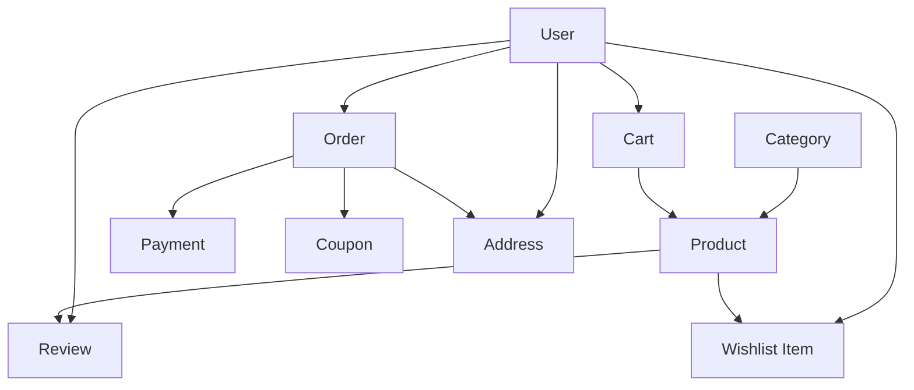
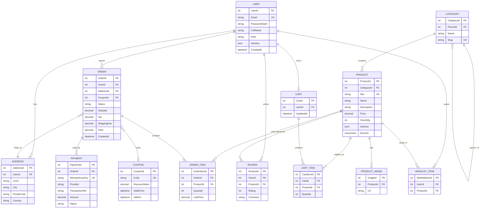
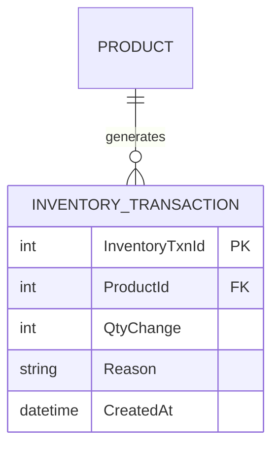
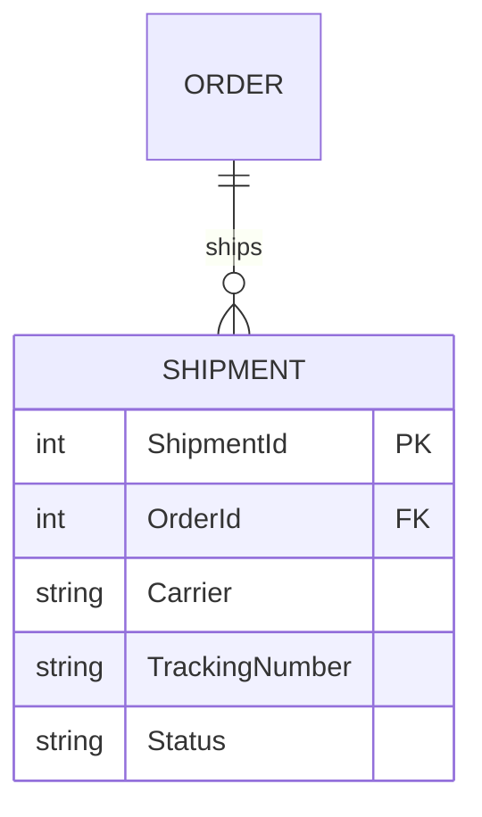
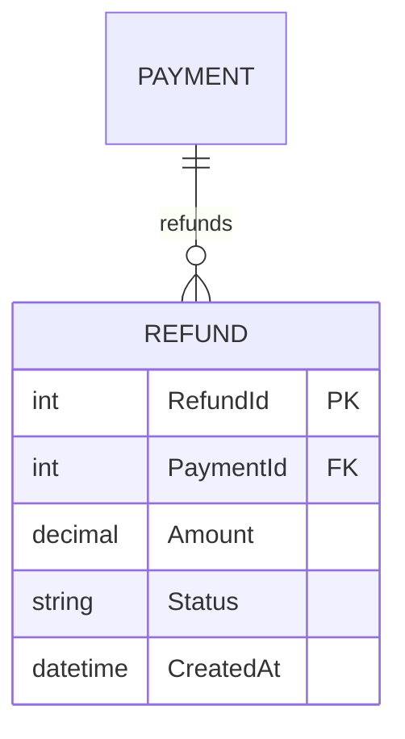
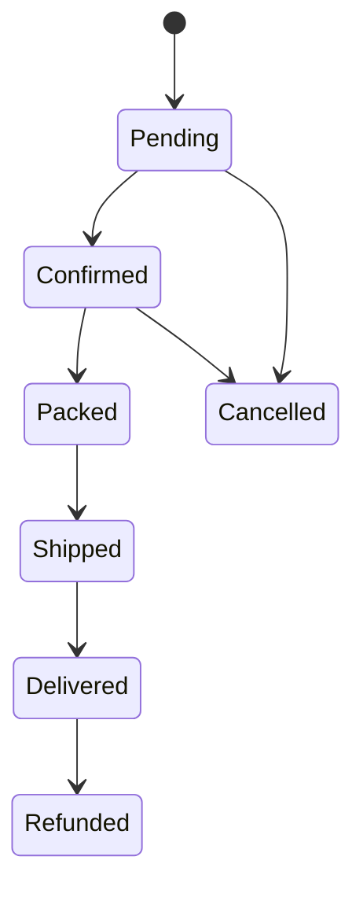
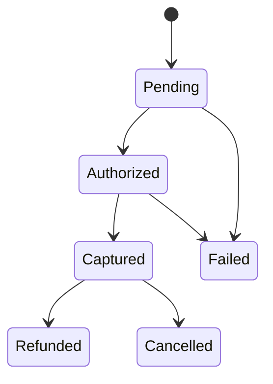

# E-Commerce Platform Database Design

## Overview

This document describes the database design for a scalable e-commerce platform supporting:

- User Management
- Product Catalog
- Shopping Cart
- Orders
- Payments
- Coupons
- Reviews
- Wishlist
- Inventory Management

---

# High-Level Domain Model



---

# Entity Relationship Diagram (ERD)



---

# Entity Descriptions

## USER

Stores customer and administrator accounts.

| Column | Description |
|----------|-------------|
| UserId | Primary Key |
| Email | Unique login email |
| PasswordHash | Hashed password |
| FullName | Customer name |
| Role | Customer/Admin |
| IsActive | Active account flag |
| CreatedAt | Registration timestamp |

---

## ADDRESS

Stores user addresses.

**Relationship**

- One User → Many Addresses

---

## CATEGORY

Supports hierarchical product categorization.

Example:

```text
Electronics
 ├── Mobile Phones
 ├── Laptops
 └── Accessories
```

---

## PRODUCT

Central catalog entity.

Features:

- SKU management
- Pricing
- Inventory tracking
- Concurrency handling via RowVersion

---

## PRODUCT_IMAGE

Stores multiple product images.

Relationship:

```text
Product
 ├── Image1
 ├── Image2
 └── Image3
```

---

## CART & CART_ITEM

Supports shopping cart functionality.

Relationship:

```text
Cart
 ├── Product A x2
 ├── Product B x1
 └── Product C x5
```

---

## ORDER & ORDER_ITEM

Represents customer purchases.

### Why UnitPrice Exists?

Product price may change later.

OrderItem stores historical purchase price:

```text
Laptop Current Price = $1200

Customer Purchased At = $999

OrderItem.UnitPrice = $999
```

---

## PAYMENT

Supports:

- Credit Cards
- UPI
- PayPal
- Stripe
- RazorPay
- Multiple payment retries

Includes idempotency support.

---

## COUPON

Discount management.

Examples:

```text
WELCOME10
SUMMER20
BLACKFRIDAY50
```

---

## REVIEW

Stores ratings and customer feedback.

Possible Rating Scale:

```text
1 = Poor
2 = Fair
3 = Average
4 = Good
5 = Excellent
```

---

## WISHLIST_ITEM

Tracks products users intend to purchase later.

---

# Important Design Strengths

## Unique Constraints

### User Email

```sql
UNIQUE (Email)
```

### Product SKU

```sql
UNIQUE (Sku)
```

### Coupon Code

```sql
UNIQUE (Code)
```

### Payment Idempotency Key

```sql
UNIQUE (IdempotencyKey)
```

---

## Optimistic Concurrency

```sql
RowVer ROWVERSION
```

Prevents inventory update conflicts.

Example:

```text
User A buys product
User B buys same product

RowVersion detects conflict
before stock update commit
```

---

# Recommended Additional Constraints

## Review Constraint

Prevent multiple reviews.

```sql
UNIQUE(UserId, ProductId)
```

---

## Wishlist Constraint

Prevent duplicate wishlist records.

```sql
UNIQUE(UserId, ProductId)
```

---

## Cart Item Constraint

Prevent duplicate products inside a cart.

```sql
UNIQUE(CartId, ProductId)
```

---

# Recommended Production Enhancements

## Audit Columns

Add to most entities:

```sql
CreatedAt
UpdatedAt
CreatedBy
UpdatedBy
```

---

## Soft Deletes

```sql
IsDeleted BIT
DeletedAt DATETIME NULL
```

Useful for:

- Products
- Categories
- Users
- Reviews

---

## Inventory Reservation

Instead of:

```sql
StockQty
```

Use:

```sql
StockQty
ReservedQty
```

Formula:

```text
AvailableQty = StockQty - ReservedQty
```

---

# Additional Enterprise Tables

## InventoryTransaction



Reasons:

- Purchase
- Return
- Stock Adjustment
- Cancellation
- Shipment

---

## Shipment



---

## Refund



---

# Order State Machine



---

# Payment State Machine



---

# Checkout Flow

```mermaid
flowchart LR

    A[Browse Products]
    B[Add To Cart]
    C[Checkout]
    D[Apply Coupon]
    E[Select Address]
    F[Create Order]
    G[Process Payment]
    H[Update Inventory]
    I[Create Shipment]
    J[Deliver Order]

    A --> B
    B --> C
    C --> D
    D --> E
    E --> F
    F --> G
    G --> H
    H --> I
    I --> J
```



---

# Architecture Assessment

## Strengths

- Proper normalization
- Supports hierarchical categories
- Supports shopping carts
- Supports order management
- Handles payment idempotency
- Supports reviews and wishlists
- Includes optimistic concurrency control
- Preserves historical pricing

## Recommended Before Production

- Inventory transactions
- Shipment tracking
- Refund management
- Address snapshots
- Soft delete support
- Audit columns
- Composite unique constraints
- Inventory reservation workflow
- Event-driven stock updates

---

