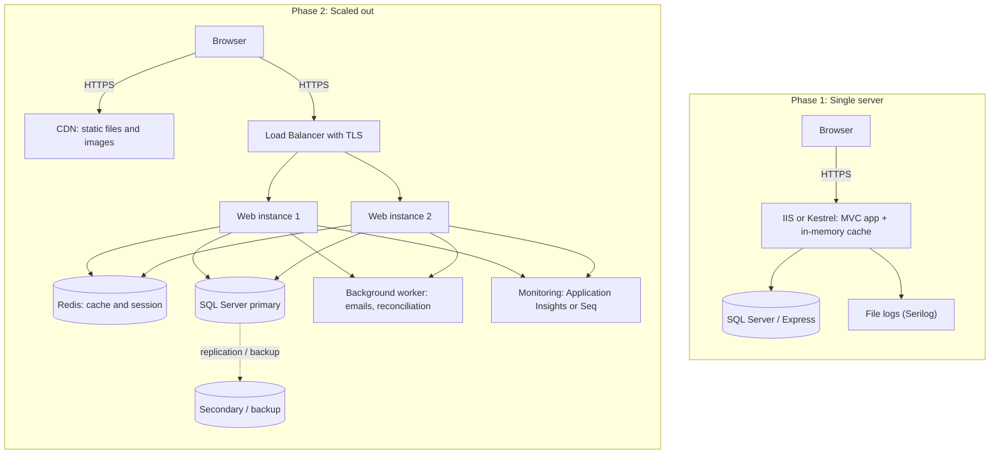
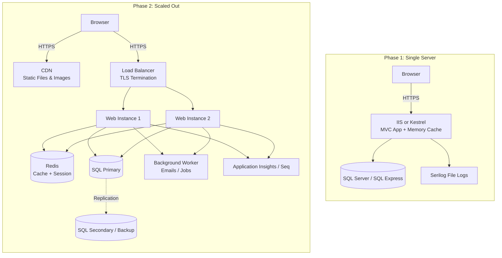

# E-Commerce Platform - Deployment


# ASP.NET Core MVC Deployment Evolution Roadmap

This document describes a typical deployment evolution roadmap for an ASP.NET Core MVC application as traffic and business requirements grow.

---

# Deployment Evolution Diagram



---

# Phase 1: Single-Server Architecture

## Suitable For

- Startup products
- Internal business applications
- MVPs
- Applications with hundreds of daily users

## Architecture

```text
Browser
   ↓
ASP.NET MVC App
   ↓
SQL Server
```

---

## Components

### Web Server

Runs:

- Controllers
- Razor Views
- Business Services
- EF Core
- In-Memory Cache

Example:

```csharp
builder.Services.AddMemoryCache();
```

---

### Database

Typically:

- SQL Server Express
- SQL Server Standard

Stores:

- Products
- Orders
- Customers
- Payments

---

### Logging

Using Serilog File Sink:

```csharp
.WriteTo.File("logs/app.log")
```

---

## Advantages

✅ Simple

✅ Cheap

✅ Easy deployment

✅ Easy debugging

✅ Suitable until traffic becomes significant

---

## Limitations

### Single Point of Failure

If the server crashes:

- Website Down
- Database Down
- Cache Lost

### Scale Limitation

Eventually the following become bottlenecks:

- CPU
- RAM
- Database Connections
- Disk I/O

---

# Phase 2: Scaled-Out Architecture

As traffic grows:

```text
1 Server → Multiple Servers
```

---

## CDN Layer

```text
Browser
   ↓
CDN
```

Stores:

- Images
- CSS
- JavaScript
- Product Thumbnails

### Benefits

- Reduces latency
- Reduces web-server bandwidth
- Improves page load time

### Examples

- Azure CDN
- Cloudflare
- Akamai

---

## Load Balancer

```text
Browser
   ↓
Load Balancer
```

Distributes traffic across multiple instances:

```text
Request #1 → Web1
Request #2 → Web2
Request #3 → Web1
```

### Examples

- Azure Application Gateway
- Azure Front Door
- Nginx
- AWS ALB

---

## Multiple Web Instances

```text
W1
W2
W3
...
```

Each instance hosts the same MVC application.

### Services Hosted

- MVC Application
- Catalog Service
- Order Service
- Identity

### Benefits

✅ Horizontal Scaling

✅ High Availability

✅ Rolling Deployments

---

## Why Redis Becomes Necessary

In a single-server architecture, in-memory cache works:

```csharp
builder.Services.AddMemoryCache();
```

However, in a multi-server environment:

```text
Web1 Cache != Web2 Cache
```

### Problem

```text
User hits Web1
Cart stored in memory

Next request hits Web2

Cart disappears
```

### Solution

Use a distributed cache.

Redis becomes the single source of cache truth.

```csharp
builder.Services.AddStackExchangeRedisCache(...)
```

---

## Session Storage

Avoid:

```text
InProc Session
```

Use:

```text
Redis-backed Session Storage
```

Configuration:

```csharp
builder.Services.AddSession();
```

### Result

Users can hit any server and their session remains available.

---

## Database Layer

All instances connect to the same primary database.

```text
Web1 → SQL Primary
Web2 → SQL Primary
```

The primary handles:

- Reads
- Writes
- Transactions

---

## Secondary Database

```text
Primary
   ↓
Replication
   ↓
Secondary
```

### Purpose

#### Disaster Recovery

If the primary fails:

```text
Promote Secondary
```

#### Reporting

Heavy reporting workloads can run on the secondary database without affecting production.

---

## Background Worker

A very important enterprise addition.

### Bad Approach

```text
Place Order
   ↓
Send Email
   ↓
Generate Invoice PDF
   ↓
Call Payment Gateway
```

The user waits until all operations complete.

---

### Better Approach

```text
Place Order
    ↓
Queue Job
    ↓
Return Success
```

Background workers handle:

- Email Sending
- Payment Reconciliation
- Invoice Generation
- Inventory Synchronization

### Common Technologies

- Hangfire
- Azure Functions
- Worker Service
- Quartz.NET

---

## Monitoring Layer

Every production system should capture:

### Logs

- Errors
- Exceptions
- Warnings

### Metrics

- CPU Usage
- Memory Usage
- Response Time
- Throughput

### Traces

- Request Flow
- Database Calls
- External API Calls

### Common Platforms

- Application Insights
- Seq
- Elastic Stack
- Grafana
- OpenTelemetry

---

# Typical Request Flow

## Standard Request

```text
Browser
   ↓
CDN
   ↓
Load Balancer
   ↓
Web Instance
   ↓
Redis Cache Check
   ↓
Database
   ↓
Response
```

---

## Order Processing Request

```text
Browser
   ↓
Load Balancer
   ↓
Order Controller
   ↓
Order Service
   ↓
Redis
   ↓
SQL Primary
   ↓
Queue Background Job
   ↓
Return Success
```

---

# Phase 3: Large-Scale Enterprise Architecture

For organizations operating at Amazon, Flipkart, or Microsoft scale:

```text
CDN
  ↓
API Gateway
  ↓
Microservices
  ↓
Message Bus
  ↓
Redis Cluster
  ↓
SQL Cluster
```

### Additional Components

- Kubernetes
- Service Bus / RabbitMQ / Kafka
- OpenTelemetry
- Distributed Tracing
- Circuit Breakers
- CQRS
- Event Sourcing (where justified)

---

# Architecture Assessment

## Phase 1

Ideal for:

- MVPs
- Internal applications
- Small-to-medium traffic loads

A properly designed Phase 1 system can often handle tens of thousands of requests per day.

---

## Phase 2

The typical enterprise-grade ASP.NET Core deployment architecture.

### Provides

✅ Horizontal Scaling

✅ High Availability

✅ Distributed Caching

✅ Background Processing

✅ Database Resilience

✅ Centralized Monitoring

---

## Recommendation

Most organizations adopt **Phase 2** before considering a microservices architecture.

Phase 2 offers an excellent balance between:

- Simplicity
- Scalability
- Operational maturity
- Cost effectiveness

Only when domain complexity and scaling requirements demand it should organizations move toward **Phase 3** and microservices.


