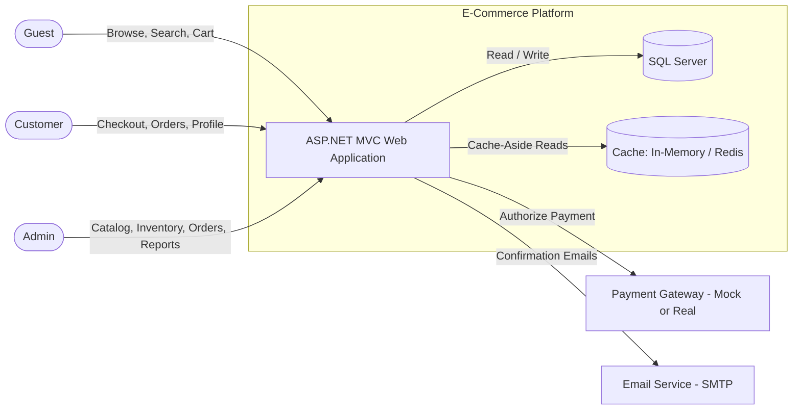

# System Context Diagram
## E-Commerce Platform

## Purpose

This system context diagram provides a high-level view of the E-Commerce Platform, showing the external actors, supporting services, and core system components with which the platform interacts.

---

## System Context Diagram

---

# System Description

The E-Commerce Platform is a web-based application developed using ASP.NET MVC. It enables customers to browse products, manage shopping carts, place orders, and make payments online. Administrative users can manage catalogs, inventory, users, and orders through a secured administration portal.

---

# Actors

## Guest

An anonymous user who can:

- Browse product catalog
- Search products
- View product details
- Add products to cart

## Customer

A registered user who can:

- Manage profile information
- Manage addresses
- Checkout and place orders
- View order history
- Track orders
- Receive notifications

## Admin

An internal system administrator who can:

- Manage products
- Manage inventory
- Process orders
- Manage users
- Generate reports
- Configure promotions and discounts

---

# Core Components

## ASP.NET MVC Web Application

The primary application responsible for:

- User interaction
- Business logic execution
- Authentication and authorization
- Cart management
- Order processing
- Payment processing integration
- Email notification generation

---

## SQL Server Database

Stores all persistent application data including:

- Users
- Roles
- Products
- Categories
- Inventory
- Shopping carts
- Orders
- Payments
- Reviews
- Coupons

---

## Cache Layer

Technology Options:

- ASP.NET In-Memory Cache
- Redis Cache

Responsibilities:

- Product catalog caching
- Frequently accessed lookup data
- Session optimization
- Performance improvement

Pattern Used:

- Cache-Aside Pattern

---

# External Systems

## Payment Gateway

Responsible for:

- Payment authorization
- Payment validation
- Transaction status response

Examples:

- Stripe
- PayPal
- Razorpay
- Mock Payment Provider (Development)

---

## Email Service

Responsible for:

- Order confirmation emails
- Registration notifications
- Password reset emails
- Shipping notifications

Technology:

- SMTP Server
- SendGrid
- MailKit SMTP Integration

---

# Data Flow Summary

| Source | Destination | Purpose |
|----------|-------------|---------|
| Guest | Web Application | Browse, Search, Cart |
| Customer | Web Application | Checkout, Orders, Profile |
| Admin | Web Application | Catalog and Order Management |
| Web Application | SQL Server | Data Persistence |
| Web Application | Cache | Fast Data Retrieval |
| Web Application | Payment Gateway | Payment Authorization |
| Web Application | Email Service | Customer Notifications |

---

# Architectural Characteristics

## Architecture Style

- Layered Architecture
- MVC Pattern
- Cache-Aside Pattern

## Technology Stack

### Frontend

- ASP.NET MVC Views
- Bootstrap
- JavaScript
- jQuery

### Backend

- ASP.NET MVC
- C#
- Entity Framework

### Database

- SQL Server

### Caching

- In-Memory Cache
- Redis

### External Integrations

- Payment Gateway
- SMTP Email Service

---

# Non-Functional Goals

- Security through Authentication and Authorization
- Scalability using Caching
- Maintainability through Layered Design
- Reliability through Transaction Management
- Performance through Cache Optimization
- Auditability through Logging and Reporting

---

# Context Boundary

The following components are considered inside the system boundary:

- ASP.NET MVC Web Application
- SQL Server Database
- Cache Layer

The following components are external systems:

- Payment Gateway
- Email Service
- Guest Users
- Customers
- Administrators

---

**Document Type:** System Context Diagram (C4 Level 1 / High-Level Architecture View)  
**Project:** E-Commerce Platform  
**Technology Stack:** ASP.NET MVC + SQL Server