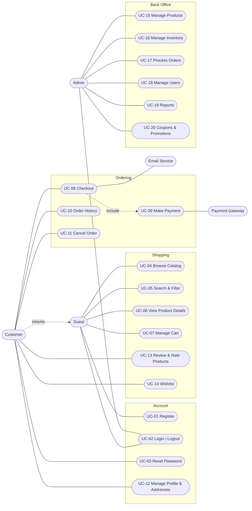

# E-Commerce Platform - Use Case Diagram

## Overview

This diagram illustrates the primary actors and use cases of the E-Commerce Platform.

### Actors

- Guest
- Customer
- Admin
- Payment Gateway
- Email Service

---

## Use Case Diagram



---

## Functional Areas

### Account Management

| Use Case | Description |
|-----------|-------------|
| UC-01 | Register |
| UC-02 | Login / Logout |
| UC-03 | Reset Password |
| UC-12 | Manage Profile & Addresses |

### Shopping

| Use Case | Description |
|-----------|-------------|
| UC-04 | Browse Catalog |
| UC-05 | Search & Filter Products |
| UC-06 | View Product Details |
| UC-07 | Manage Shopping Cart |
| UC-13 | Review & Rate Products |
| UC-14 | Wishlist Management |

### Ordering

| Use Case | Description |
|-----------|-------------|
| UC-08 | Checkout |
| UC-09 | Make Payment |
| UC-10 | Order History |
| UC-11 | Cancel Order |

### Administration

| Use Case | Description |
|-----------|-------------|
| UC-15 | Manage Products |
| UC-16 | Manage Inventory |
| UC-17 | Process Orders |
| UC-18 | Manage Users |
| UC-19 | Reports & Analytics |
| UC-20 | Coupons & Promotions |

### External Systems

| System | Purpose |
|----------|---------|
| Payment Gateway | Payment Processing |
| Email Service | Order Confirmation & Notifications |

---

## Notes

- Customer inherits all Guest capabilities.
- Checkout includes payment processing.
- Payment authorization is handled through an external Payment Gateway.
- Order confirmations and notifications are sent through the Email Service.
- Administrative functions are restricted to Admin users.
```
